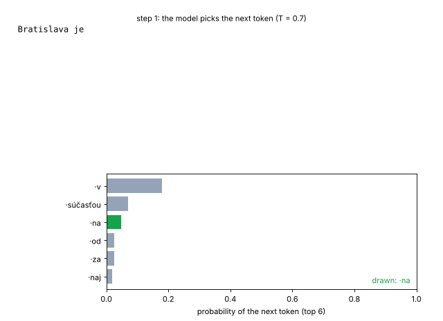
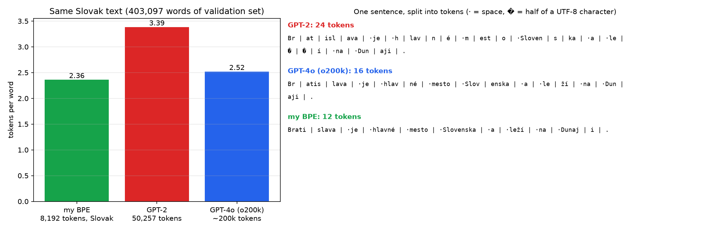
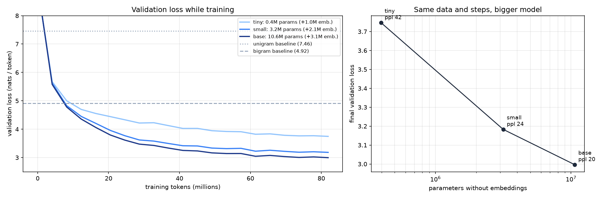
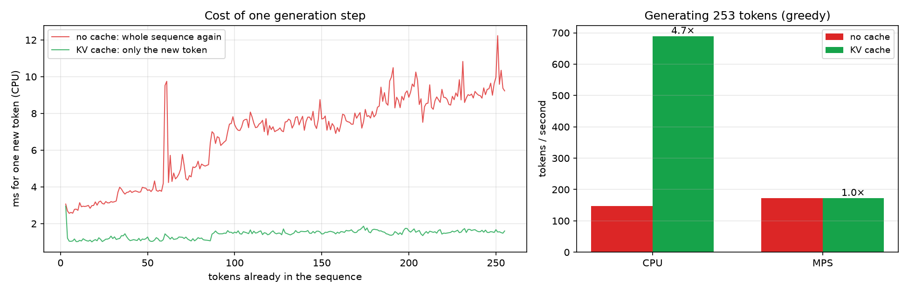
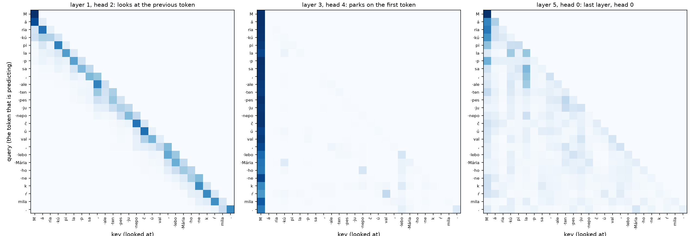

# 12 · GPT from scratch on Slovak

🇸🇰 [Slovenská verzia](README.sk.md)

## TL;DR
Roadmap project P4: my own byte-level BPE tokenizer and a decoder-only transformer, both written from scratch and trained on 297 million characters of Slovak Wikipedia on a Mac mini (M4 Pro, MPS). Every number comes from the `results_*.json` files.

- **Tokenizer:** my 8,192-token BPE needs **2.36 tokens per Slovak word**. GPT-2's tokenizer (50,257 tokens) needs **3.39**, so Slovak costs 43 % more tokens there. GPT-4o's o200k (~200,000 tokens) needs 2.52.
- **Model:** a 13.8M-parameter GPT (6 layers, 384 wide) reaches validation loss **2.997 (perplexity 20.0)** after 82M tokens in 41 minutes. The bigram baseline has perplexity 136.4 and the unigram baseline 1,741.
- **Scaling:** with the same data and steps, 0.4M → 3.2M → 10.6M non-embedding parameters give perplexity 42.4 → 24.1 → 20.0.
- **KV cache:** on the CPU, generation goes from 147 to 689 tokens/s (**4.7×**), with token-for-token identical output. On MPS it gives nothing (173 vs 172 tokens/s), because a model this small spends its time on GPU overhead, not on arithmetic.
- **Text:** at temperature 0.7 the model writes grammatical Slovak in the shape of a Wikipedia article ("Dejiny", years, places), but the facts are invented.



## Start here
Think of text completion on a phone: given a few words, the system guesses what comes next. This project builds a small version of that idea for Slovak. **The input** is Slovak Wikipedia articles; **the output** is a model that can continue a prompt one token (a piece of a word) at a time.

First, a **tokenizer** splits text into pieces and assigns each one a number. Then a GPT model is built: for each piece, it looks at earlier pieces and predicts the next one. During training, wrong predictions produce a loss and the model adjusts its weights. On held-out articles the final model reaches perplexity 20.0 versus 136.4 for a simple bigram baseline; lower means better next-token predictions.

The GIF shows generation step by step. Other plots compare tokenizers, model sizes, and generation speed with a **KV cache** (saved intermediate calculations). The model produces article-like text but may invent facts. The project demonstrates the whole path from data preparation to training and measuring a small GPT, not reliable question answering.

## Problem
Every LLM in phases 2–4 of the roadmap is a stack of the same pieces: a tokenizer, embeddings, self-attention, MLP blocks and a sampling loop. P4 builds all of them by hand, small enough to train on a Mac, so that later "fine-tune Qwen" or "RAG with a local model" are no longer black boxes. Slovak is the deliberate twist: tokenizers built mostly for English make Slovak longer and therefore more expensive and worse, which matters for the SK/CZ market.

Done when (from the roadmap): tokens per word of my tokenizer vs GPT-2's on Slovak text, a validation-loss curve with samples at several temperatures, and a KV cache with measured speed-up. All three are below.

Sources: Karpathy's "Let's build GPT" and "Let's build the GPT Tokenizer", Raschka's *Build a Large Language Model (From Scratch)*.

## Setup
| | |
|---|---|
| Data | Slovak Wikipedia, dump 2023-11-01 (`wikimedia/wikipedia`, config `20231101.sk`, one 240 MB Parquet file). Of 242,235 articles, 106,133 have at least 500 characters (shorter ones are mostly one-line stubs of villages that repeat a template). Shuffled with seed 0, 1 % of articles held out: **105,072 train / 1,061 validation articles**, 297.2M / 2.8M characters. |
| Tokens | 97.3M train, 0.95M validation (with my tokenizer) |
| Hardware | Mac mini M4 Pro, 48 GB, PyTorch on MPS; generation also on the CPU |
| Training | 5,000 steps × 64 sequences × 256 tokens = 81.9M tokens = 0.84 epochs, so no training token was seen twice. AdamW (β = 0.9 / 0.95, weight decay 0.1 on matrices only), 200 warm-up steps, cosine to 10 % of the peak, gradient clipping 1.0, seed 0. |
| Baselines | uniform, unigram and bigram (add-0.01 smoothing) on the same validation tokens |

## How it works

### 1. Data (`data.py`)
Whole articles are shuffled before the split, so validation is not one alphabetical block of titles. Articles are joined with a special `<|endoftext|>` token, so the model also learns where an article ends.

### 2. My BPE tokenizer (`bpe.py`)
1. **Pre-split** the text with GPT-2's regex into chunks: a word with its leading space, a number, punctuation. Merges never cross a chunk border, so "mesto." never becomes one token with the dot.
2. **Start from bytes.** Every chunk begins as its UTF-8 bytes, so there are 256 starting symbols and nothing is ever "unknown". "š" is 2 bytes in UTF-8, and that is exactly where an English tokenizer loses on Slovak.
3. **Merge the most frequent pair**, give it a new id, repeat 7,935 times. Done naively (recount all pairs after every merge), that would take hours on 40M characters. The code only recounts the chunks that contained the merged pair and keeps a heap of counts, so training takes **43 s** on the Mac. On a small text I checked that it learns exactly the same merges as the naive version (300 of 300).
4. **Encoding** applies merges in the order they were learned. Results are cached per chunk, since Wikipedia repeats the same words millions of times.



The same sentence is 12 tokens for my tokenizer, 16 for GPT-4o and 24 for GPT-2, which cuts "leží" into `·le` + two halves of "ž" + `í`. My vocabulary is 6× smaller than GPT-2's and 24× smaller than GPT-4o's, but all of it is spent on Slovak.

### 3. The model (`model.py`)
```
token ids → token embedding + position embedding
          → 6 × [ x + Attention(LayerNorm(x)),  x + MLP(LayerNorm(x)) ]
          → LayerNorm → logits over 8,192 tokens
```
- **Self-attention** is written by hand. Each token makes a query (what am I looking for?), a key (what do I contain?) and a value (what do I pass on?). The score q·k/√d says how well a query matches a key. The **causal mask** sets the scores for future tokens to −∞ before the softmax, so a token can only look back. Six heads each work in a 64-dimensional slice and are glued back together.
- **Residual connections + pre-LayerNorm**, as in GPT-2: every block only *adds* a correction to x, so the gradient has a direct path through all layers.
- **Weight tying:** the output layer reuses the embedding matrix. That saves 3.1M parameters, which is 23 % of the base model.
- **Initialisation:** weights ~ N(0, 0.02). The layers that write into the residual stream are scaled down by 1/√(2·layers), so the sum over 6 layers stays the same size at the start.
- **Learned positions** (as in GPT-2), up to 256 tokens. RoPE is the stretch goal.

| Size | layers × width × heads | all parameters | without embeddings |
|---|---|---|---|
| tiny | 2 × 128 × 4 | 1.45M | 0.40M |
| small | 4 × 256 × 4 | 5.26M | 3.16M |
| base | 6 × 384 × 6 | 13.79M | 10.65M |

### 4. Training (`train.py`)
My own loop, no Lightning: random 256-token windows from the token file (the target is the same window shifted by one), cross-entropy loss, AdamW, warm-up and then cosine decay, gradient clipping. Every 250 steps it measures validation loss on 40 batches. Weight decay applies to matrices only; biases, LayerNorm gains and embeddings are left alone, as in GPT-2. The peak learning rate is 6·10⁻⁴ for base, 10⁻³ for small and 2·10⁻³ for tiny, because smaller models tolerate larger steps.

### 5. Sampling and the KV cache (`generate.py`)
- **Temperature** divides the logits before the softmax. T < 1 sharpens the distribution (safer, more repetitive), T > 1 flattens it (more varied, more broken words). **Top-k** keeps only the k most likely tokens. **Top-p** keeps the smallest set whose probabilities add up to p.
- **KV cache:** because of the causal mask, the keys and values of earlier tokens never change. So instead of pushing the whole sequence through the model for every new token (O(T²) attention work per token), the model keeps K and V for each layer and computes only the new token's q, k, v. The check: greedy generation with and without the cache produces **identical** 253 tokens, on both the CPU and MPS.

## Results

### Validation loss
| Model | validation loss | perplexity | training time (MPS) | tokens / s |
|---|---|---|---|---|
| uniform (every token 1/8192) | 9.011 | 8,192 | | |
| unigram | 7.462 | 1,740.6 | | |
| bigram (add-0.01) | 4.916 | 136.4 | | |
| GPT tiny (0.4M) | 3.747 | 42.4 | 6.6 min | 205,801 |
| GPT small (3.2M) | 3.183 | 24.1 | 17.4 min | 78,445 |
| **GPT base (10.6M)** | **2.997** | **20.0** | 40.6 min | 33,650 |



small and base drop below the bigram after 8M training tokens, tiny after 12M. Perplexity 20 means that the base model, on average, is as unsure about the next token as if it were picking uniformly from 20 options, against 136 for the bigram. Over these sizes, every 8× more parameters (tiny → small) lowered the loss by 0.56, the next 3.4× (small → base) by 0.19. All curves are still falling at the end, so with more steps all three would improve. The data would allow it: training used 84 % of one epoch.

### Samples (base model, seed 0, 60 new tokens)
| T | „Bratislava je …“ |
|---|---|
| 0.2 | *Bratislava je v súčasnosti v obci v okrese Púchov. Poloha: Obec leží v strednej časti pohoria …* (a village template) |
| 0.7 | *Bratislava je vybudovaná v roku 1986. Dejiny: V roku 2010 bola pribudnutá trať na trať bývalá železnica, ktorá bola vybudovaná v roku 1992.* |
| 1.0 | *Bratislava je ochrana v meste. V roku 2022 bol založený panel Karel Vhodilhovský I. triedy …* |
| 1.5 | *Bratislava je ochranou v dizajbáove PHUP vyvinuté v sú piati ro IRF …* (broken words) |
| 1.0, top-k 50 | *Bratislava je vybudovaná v roku 1986. Päť miest vedie z Bratislavy.* |

At T = 0.2, "V roku 1993" falls into a loop: *V roku 2000 bol členom skupiny ASM.* four times in a row. All samples, including the prompt "Poisťovňa", are in `results_generate.json`.

### KV cache
| Device | without cache | with cache | speed-up | same output |
|---|---|---|---|---|
| CPU | 147.4 tokens/s | 689.3 tokens/s | **4.7×** | yes |
| MPS | 172.9 tokens/s | 172.2 tokens/s | 1.0× | yes |



On the CPU, the cost of one step without a cache grows with the length (about 3 ms with 3 tokens, 9.2 ms with 255). With the cache it stays at about 1–1.6 ms after the first step. On MPS each step takes the same time either way. With 13.8M parameters and one token at a time, the GPU waits for kernel launches and data transfers, not for arithmetic, so removing arithmetic changes nothing. With the cache, the CPU generates 4× faster than the GPU here. The cache matters when the model is big or the batch is large, which is the normal case in serving (P10).

## Visual example: attention, not cars
The cars would be forced here: a transformer is about sequences of tokens. The visuals are the generation GIF at the top and the attention maps of the base model on the sentence *„Mária kúpila psa, ale ten pes ju nepočúval, lebo Mária ho nekŕmila.“*



- **Layer 1, head 2** (counting from 0) puts **51 %** of its attention on the previous token: a clean diagonal. Heads like this help build the "induction" pattern (if A was followed by B earlier, predict B after A again).
- **Layer 3, head 4** puts **90 %** of its attention on the very first token. That is a known trick ("attention sink"): softmax must give out 100 %, so a head with nothing useful to do parks it on a token that changes nothing.
- The **last layer** spreads its attention more widely and back to earlier words of the sentence.

Tokenization is visible here too: at the start of the sentence "Mária" is 3 tokens (`M`, `á`, `ria`). Later, " Mária" with a leading space is **one** token, because Wikipedia mostly has the name in the middle of a sentence.

## Error analysis
- **Fluent, not true.** The grammar and the Wikipedia layout ("Dejiny", "Poloha", years) are right; the facts are made up ("Bratislava … v okrese Púchov"). With 10M parameters and 82M tokens, the model learns the form of the text much sooner than knowledge.
- **Low temperature loops.** T = 0.2 repeats the same sentence. The model keeps picking the most likely continuation, and a sentence it has just written makes itself more likely. T = 0.7–1.0 or top-k/top-p break the loop.
- **High temperature breaks words.** At T = 1.5 the long tail of unlikely sub-word tokens gets enough probability to glue together non-words ("dizajbáove").
- **Train loss is above validation loss** (base: 3.12 vs 3.00 at the end, and about 0.1 above at the earlier checkpoints too). It is not overfitting the other way round. The model never saw a training token twice and has no dropout, so the two numbers measure the same thing on different text. The reported train loss is the mean of the last 250 steps, while the model was still improving, which explains part of it. Whether the 1,061 validation articles are also slightly easier I have not checked.
- **One seed, one run per size.** The differences between sizes (0.19–0.56 in loss) are much bigger than the wobble between neighbouring evaluations (0.02–0.03), but a second seed was not run.

## What I learned
- A tokenizer trained on the target language matters more than vocabulary size: 8k Slovak tokens beat 200k multilingual ones on Slovak (2.36 vs 2.52 tokens/word). GPT-2 needs 43 % more tokens, so 43 % more money, latency and context.
- BPE is simple; training it fast is the work. Incremental pair counts with a heap turn hours into 43 s.
- The causal mask is the whole difference between "predict the next token" and "copy the answer". And it is also what makes the KV cache possible: old keys and values can never change.
- A KV cache is an asymptotic win (O(T) instead of O(T²) per token) that shows up only where arithmetic is the bottleneck. On a GPU with a tiny model it is invisible, so measure before believing.
- Perplexity has to be read against baselines on the same tokens: 20 means little alone, but against 136 for the bigram and 1,741 for the unigram it shows what context buys.
- A bigger model is better at the same number of steps, but it is also slower per step. tiny reached perplexity 42 in 6.6 minutes, base 20 in 40.6 minutes.

## Run it
```bash
uv sync
uv run python data.py        # downloads 240 MB → data/sk_train.txt, sk_val.txt
uv run python bpe.py         # trains my BPE on 40M characters → models/bpe_sk.json (~1 min)
uv run python prepare.py     # encodes → data/train.bin, val.bin + tokenizer comparison (needs tiktoken downloads)
uv run python baselines.py   # uniform / unigram / bigram
uv run python train.py --size base --steps 5000    # ~41 min on M4 Pro (MPS); also --size small / tiny
uv run python generate.py    # samples, KV-cache benchmark, attention maps
uv run python plot.py        # assets/*.png, assets/generation.gif
```
Or `make all STEPS=5000`.

## Limitations
- One seed per model size; no learning-rate search, each size got one hand-picked peak learning rate.
- Context of 256 tokens with learned positions, so the model cannot generate past 256 tokens. RoPE and grouped-query attention (the stretch goal) are not done, nor is the MLX port.
- The validation set is Wikipedia like the training set. Perplexity on other Slovak text (news, forums) would be higher.
- The KV-cache numbers are for batch size 1 on one Mac mini; the CPU line has outliers from other work on the machine.
- The tokenizer comparison uses text from the same Wikipedia as my tokenizer's training data (different articles), which favours my tokenizer a little.
