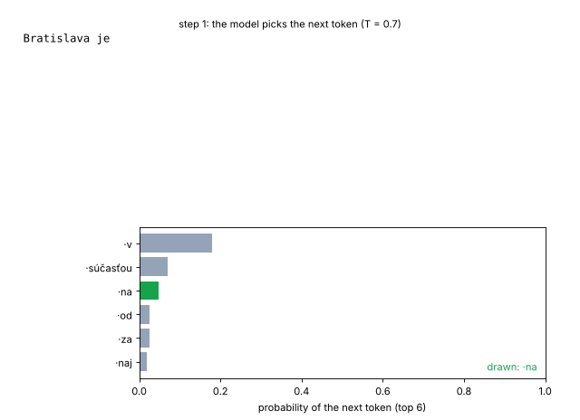
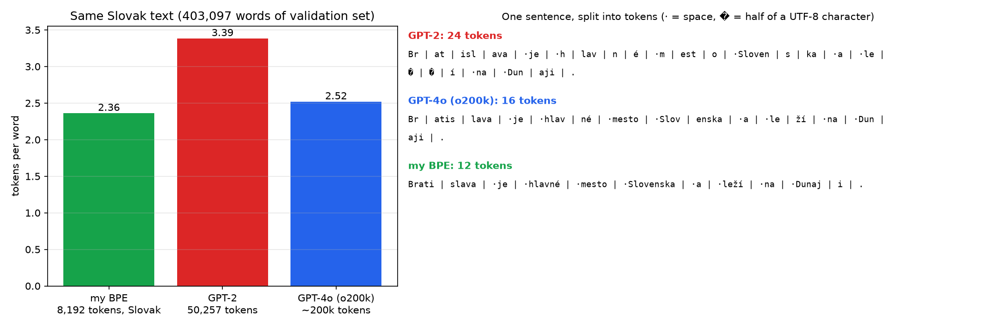
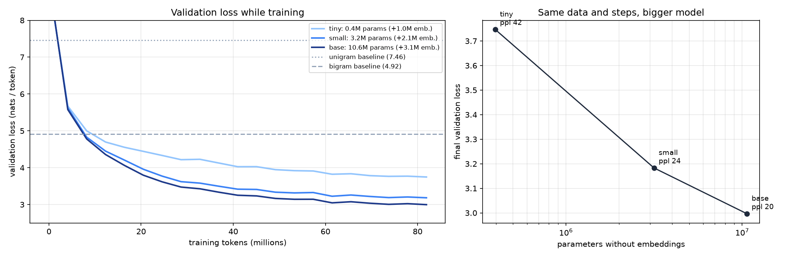
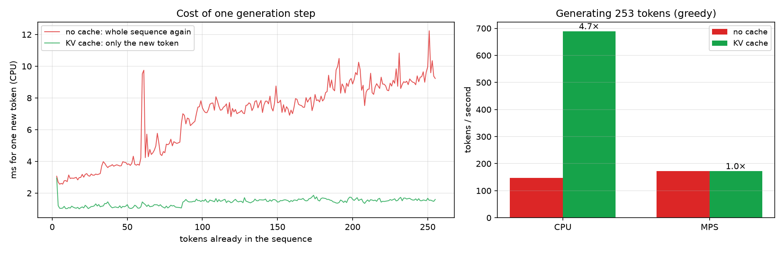
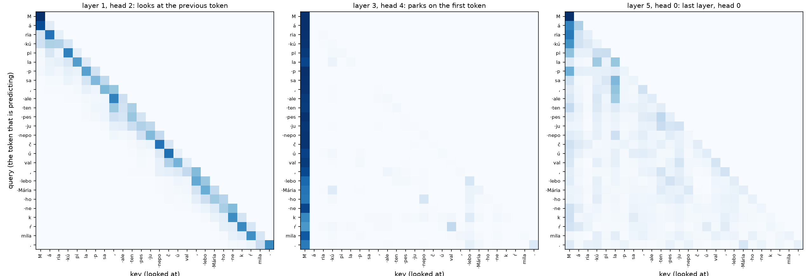

# 12 · GPT od nuly na slovenčine

🇬🇧 [English version](README.md)

## TL;DR
Projekt P4 z roadmapy: vlastný bajtový BPE tokenizer a decoder-only transformer, oba napísané od nuly a natrénované na 297 miliónoch znakov slovenskej Wikipédie na Macu mini (M4 Pro, MPS). Všetky čísla pochádzajú zo súborov `results_*.json`.

- **Tokenizer:** môj BPE s 8 192 tokenmi potrebuje **2,36 tokenu na slovenské slovo**. Tokenizer GPT-2 (50 257 tokenov) potrebuje **3,39**, takže slovenčina tam stojí o 43 % viac tokenov. o200k z GPT-4o (~200 000 tokenov) potrebuje 2,52.
- **Model:** GPT s 13,8M parametrov (6 vrstiev, šírka 384) dosiahne validačnú loss **2,997 (perplexita 20,0)** po 82M tokenoch za 41 minút. Bigramový baseline má perplexitu 136,4 a unigramový 1 741.
- **Škálovanie:** pri rovnakých dátach a krokoch dá 0,4M → 3,2M → 10,6M parametrov bez embeddingov perplexitu 42,4 → 24,1 → 20,0.
- **KV cache:** na CPU sa generovanie zrýchli zo 147 na 689 tokenov/s (**4,7×**) s rovnakým výstupom token po tokene. Na MPS nedá nič (173 vs 172 tokenov/s), lebo taký malý model trávi čas réžiou GPU, nie počítaním.
- **Text:** pri teplote 0,7 model píše gramatickú slovenčinu v tvare článku z Wikipédie („Dejiny“, roky, miesta), ale fakty si vymýšľa.



## Najprv jednoducho
Predstav si dopĺňanie textu v mobile: po niekoľkých slovách systém odhaduje, čo príde ďalej. Tento projekt stavia malú verziu takejto myšlienky pre slovenčinu. **Vstupom** sú články zo slovenskej Wikipédie; **výstupom** je model, ktorý vie po zadanom začiatku tvoriť ďalší text, po jednom tokene (kúsku slova) za druhým.

Najprv vznikne **tokenizer**, ktorý text rozdelí na kúsky a pridelí im čísla. Potom sa postaví GPT: pre každý kúsok sa pozrie na predchádzajúce kúsky a odhaduje ďalší. Pri tréningu dostane za nesprávne odhady chybu a upraví váhy. Na odložených článkoch má výsledný model perplexitu 20,0, kým jednoduchý bigramový odhad má 136,4; nižšie číslo znamená lepšiu predpoveď ďalšieho tokenu.

GIF ukazuje tvorbu textu krok po kroku. Ďalšie grafy porovnávajú tokenizery, veľkosti modelu a rýchlosť generovania s **KV cache** (uloženými medzivýsledkami). Model píše text podobný článku, ale môže si vymýšľať fakty. Projekt dokazuje zvládnutie celého postupu od spracovania dát po tréning a meranie malého GPT, nie spoľahlivé zodpovedanie otázok.

## Problém
Každé LLM vo fázach 2–4 roadmapy je kopa tých istých kúskov: tokenizer, embeddingy, self-attention, MLP bloky a slučka na vzorkovanie. P4 ich všetky postaví ručne, dosť malé na tréning na Macu, aby neskoršie „dolaď Qwen“ alebo „RAG s lokálnym modelom“ už neboli čierne skrinky. Slovenčina je zámerná zápletka: tokenizery stavané hlavne pre angličtinu robia slovenčinu dlhšou, a teda drahšou a horšou, čo je dôležité pre SK/CZ trh.

Hotové, keď (podľa roadmapy): počet tokenov na slovo môjho tokenizera vs GPT-2 na slovenskom texte, krivka validačnej loss s ukážkami pri rôznych teplotách a KV cache so zmeraným zrýchlením. Všetky tri sú nižšie.

Zdroje: Karpathy „Let's build GPT“ a „Let's build the GPT Tokenizer“, Raschka *Build a Large Language Model (From Scratch)*.

## Nastavenie
| | |
|---|---|
| Dáta | Slovenská Wikipédia, dump 2023-11-01 (`wikimedia/wikipedia`, konfigurácia `20231101.sk`, jeden 240 MB Parquet súbor). Z 242 235 článkov má 106 133 aspoň 500 znakov (kratšie sú väčšinou jednoriadkové pahýly obcí, ktoré opakujú šablónu). Zamiešané so seedom 0, 1 % článkov odložené: **105 072 tréningových / 1 061 validačných článkov**, 297,2M / 2,8M znakov. |
| Tokeny | 97,3M tréningových, 0,95M validačných (s mojím tokenizerom) |
| Hardvér | Mac mini M4 Pro, 48 GB, PyTorch na MPS; generovanie aj na CPU |
| Tréning | 5 000 krokov × 64 sekvencií × 256 tokenov = 81,9M tokenov = 0,84 epochy, takže žiadny tréningový token nevidel model dvakrát. AdamW (β = 0,9 / 0,95, weight decay 0,1 len na matice), 200 krokov warm-upu, kosínus na 10 % maxima, orezanie gradientu 1,0, seed 0. |
| Baseliny | rovnomerný, unigram a bigram (vyhladenie add-0,01) na tých istých validačných tokenoch |

## Ako to funguje

### 1. Dáta (`data.py`)
Pred rozdelením sa miešajú celé články, aby validácia nebola jeden abecedný blok názvov. Články sú spojené špeciálnym tokenom `<|endoftext|>`, takže model sa učí aj to, kde článok končí.

### 2. Môj BPE tokenizer (`bpe.py`)
1. **Predbežné delenie** textu regexom z GPT-2 na kúsky: slovo s medzerou pred ním, číslo, interpunkcia. Spájania nikdy neprekročia hranicu kúska, takže „mesto.“ sa nikdy nestane jedným tokenom aj s bodkou.
2. **Začiatok z bajtov.** Každý kúsok začína ako svoje UTF-8 bajty, takže je 256 počiatočných symbolov a nič nie je nikdy „neznáme“. „š“ má v UTF-8 2 bajty, a presne tu anglický tokenizer na slovenčine prehráva.
3. **Spoj najčastejší pár**, daj mu nové id, zopakuj 7 935-krát. Naivne (po každom spojení prepočítať všetky páry) by to na 40M znakoch trvalo hodiny. Kód prepočíta len kúsky, ktoré spájaný pár obsahovali, a počty drží v halde, takže tréning trvá na Macu **43 s**. Na malom texte som overil, že sa naučí presne tie isté spojenia ako naivná verzia (300 z 300).
4. **Kódovanie** aplikuje spojenia v poradí, v akom sa ich naučil. Výsledky sa cachujú pre každý kúsok, lebo Wikipédia opakuje tie isté slová miliónkrát.



Tá istá veta má 12 tokenov v mojom tokenizeri, 16 v GPT-4o a 24 v GPT-2, ktorý „leží“ rozseká na `·le` + dve polovice „ž“ + `í`. Môj slovník je 6× menší ako GPT-2 a 24× menší ako GPT-4o, ale celý je minutý na slovenčinu.

### 3. Model (`model.py`)
```
id tokenov → embedding tokenu + embedding pozície
           → 6 × [ x + Attention(LayerNorm(x)),  x + MLP(LayerNorm(x)) ]
           → LayerNorm → logity nad 8 192 tokenmi
```
- **Self-attention** je napísaná ručne. Každý token vyrobí query (čo hľadám?), key (čo obsahujem?) a value (čo odovzdám ďalej?). Skóre q·k/√d hovorí, ako dobre query sedí ku key. **Kauzálna maska** nastaví skóre budúcich tokenov na −∞ ešte pred softmaxom, takže token sa môže pozerať len dozadu. Šesť hláv pracuje každá v 64-rozmernom kúsku a potom sa zlepia späť.
- **Reziduálne spojenia + pre-LayerNorm**, ako v GPT-2: každý blok k x len *pripočíta* opravu, takže gradient má priamu cestu cez všetky vrstvy.
- **Weight tying:** výstupná vrstva znovu použije maticu embeddingov. To ušetrí 3,1M parametrov, čo je 23 % základného modelu.
- **Inicializácia:** váhy ~ N(0; 0,02). Vrstvy, ktoré zapisujú do reziduálneho prúdu, sú zmenšené o 1/√(2·vrstvy), aby súčet cez 6 vrstiev mal na začiatku stále rovnakú veľkosť.
- **Naučené pozície** (ako v GPT-2), do 256 tokenov. RoPE je bonusový cieľ.

| Veľkosť | vrstvy × šírka × hlavy | všetky parametre | bez embeddingov |
|---|---|---|---|
| tiny | 2 × 128 × 4 | 1,45M | 0,40M |
| small | 4 × 256 × 4 | 5,26M | 3,16M |
| base | 6 × 384 × 6 | 13,79M | 10,65M |

### 4. Tréning (`train.py`)
Vlastná slučka, bez Lightningu: náhodné okná po 256 tokenoch zo súboru tokenov (cieľ je to isté okno posunuté o jeden), cross-entropy loss, AdamW, warm-up a potom kosínusový pokles, orezanie gradientu. Každých 250 krokov zmeria validačnú loss na 40 dávkach. Weight decay platí len pre matice; biasy, zosilnenia LayerNormu a embeddingy nechá na pokoji, ako GPT-2. Maximálny learning rate je 6·10⁻⁴ pre base, 10⁻³ pre small a 2·10⁻³ pre tiny, lebo menšie modely znesú väčšie kroky.

### 5. Vzorkovanie a KV cache (`generate.py`)
- **Teplota** delí logity pred softmaxom. T < 1 rozdelenie zaostrí (bezpečnejšie, viac opakovania), T > 1 ho sploští (pestrejšie, viac rozbitých slov). **Top-k** nechá len k najpravdepodobnejších tokenov. **Top-p** nechá najmenšiu množinu, ktorej pravdepodobnosti dajú spolu p.
- **KV cache:** kvôli kauzálnej maske sa keys a values starších tokenov nikdy nemenia. Namiesto toho, aby model pre každý nový token prehnal celú sekvenciu (O(T²) práce v attention na token), si pre každú vrstvu drží K a V a počíta len q, k, v nového tokenu. Kontrola: greedy generovanie s cache aj bez nej vyrobí **rovnakých** 253 tokenov, na CPU aj na MPS.

## Výsledky

### Validačná loss
| Model | validačná loss | perplexita | čas tréningu (MPS) | tokenov / s |
|---|---|---|---|---|
| rovnomerný (každý token 1/8192) | 9,011 | 8 192 | | |
| unigram | 7,462 | 1 740,6 | | |
| bigram (add-0,01) | 4,916 | 136,4 | | |
| GPT tiny (0,4M) | 3,747 | 42,4 | 6,6 min | 205 801 |
| GPT small (3,2M) | 3,183 | 24,1 | 17,4 min | 78 445 |
| **GPT base (10,6M)** | **2,997** | **20,0** | 40,6 min | 33 650 |



small a base klesnú pod bigram po 8M tréningových tokenoch, tiny po 12M. Perplexita 20 znamená, že základný model si je pri ďalšom tokene v priemere taký neistý, ako keby rovnomerne vyberal z 20 možností, oproti 136 pri bigrame. Pri týchto veľkostiach znížilo 8× viac parametrov (tiny → small) loss o 0,56, ďalších 3,4× (small → base) o 0,19. Všetky krivky na konci ešte klesajú, takže s viac krokmi by sa zlepšili všetky tri. Dáta by to dovolili: tréning použil 84 % jednej epochy.

### Ukážky (základný model, seed 0, 60 nových tokenov)
| T | „Bratislava je …“ |
|---|---|
| 0,2 | *Bratislava je v súčasnosti v obci v okrese Púchov. Poloha: Obec leží v strednej časti pohoria …* (šablóna obce) |
| 0,7 | *Bratislava je vybudovaná v roku 1986. Dejiny: V roku 2010 bola pribudnutá trať na trať bývalá železnica, ktorá bola vybudovaná v roku 1992.* |
| 1,0 | *Bratislava je ochrana v meste. V roku 2022 bol založený panel Karel Vhodilhovský I. triedy …* |
| 1,5 | *Bratislava je ochranou v dizajbáove PHUP vyvinuté v sú piati ro IRF …* (rozbité slová) |
| 1,0, top-k 50 | *Bratislava je vybudovaná v roku 1986. Päť miest vedie z Bratislavy.* |

Pri T = 0,2 spadne „V roku 1993“ do slučky: *V roku 2000 bol členom skupiny ASM.* štyrikrát za sebou. Všetky ukážky vrátane promptu „Poisťovňa“ sú v `results_generate.json`.

### KV cache
| Zariadenie | bez cache | s cache | zrýchlenie | rovnaký výstup |
|---|---|---|---|---|
| CPU | 147,4 tokenov/s | 689,3 tokenov/s | **4,7×** | áno |
| MPS | 172,9 tokenov/s | 172,2 tokenov/s | 1,0× | áno |



Na CPU cena jedného kroku bez cache rastie s dĺžkou (asi 3 ms pri 3 tokenoch, 9,2 ms pri 255). S cache ostáva po prvom kroku okolo 1–1,6 ms. Na MPS trvá každý krok rovnako dlho tak či tak. Pri 13,8M parametroch a jednom tokene naraz GPU čaká na spúšťanie kernelov a presuny dát, nie na počítanie, takže ubratie počítania nič nezmení. S cache tu CPU generuje 4× rýchlejšie ako GPU. Cache sa oplatí, keď je model veľký alebo dávka veľká, čo je pri nasadení bežný prípad (P10).

## Vizuálny príklad: attention, nie autíčka
Autíčka by tu boli nasilu: transformer je o postupnostiach tokenov. Vizuálmi sú GIF s generovaním hore a mapy attention základného modelu na vete *„Mária kúpila psa, ale ten pes ju nepočúval, lebo Mária ho nekŕmila.“*



- **Vrstva 1, hlava 2** (počítané od 0) dáva **51 %** svojej pozornosti predchádzajúcemu tokenu: čistá diagonála. Takéto hlavy pomáhajú poskladať vzor „indukcie“ (ak po A predtým nasledovalo B, po A predpovedz znova B).
- **Vrstva 3, hlava 4** dáva **90 %** pozornosti úplne prvému tokenu. To je známy trik („attention sink“): softmax musí rozdať 100 %, takže hlava, ktorá nemá nič užitočné na práci, to zaparkuje na tokene, ktorý nič nezmení.
- **Posledná vrstva** rozkladá pozornosť šírš a späť na staršie slová vety.

Je tu vidno aj tokenizáciu: na začiatku vety je „Mária“ 3 tokeny (`M`, `á`, `ria`). Neskôr je „ Mária“ s medzerou pred ním **jeden** token, lebo na Wikipédii je meno väčšinou v strede vety.

## Analýza chýb
- **Plynulé, nie pravdivé.** Gramatika a rozloženie článku z Wikipédie („Dejiny“, „Poloha“, roky) sedia; fakty sú vymyslené („Bratislava … v okrese Púchov“). S 10M parametrami a 82M tokenmi sa model naučí formu textu oveľa skôr ako znalosti.
- **Nízka teplota sa zacyklí.** T = 0,2 opakuje tú istú vetu. Model stále vyberá najpravdepodobnejšie pokračovanie a veta, ktorú práve napísal, robí samu seba pravdepodobnejšou. T = 0,7–1,0 alebo top-k/top-p slučku prerušia.
- **Vysoká teplota rozbíja slová.** Pri T = 1,5 dostane dlhý chvost nepravdepodobných kúskov slov dosť pravdepodobnosti na to, aby z nich zlepil neslová („dizajbáove“).
- **Tréningová loss je nad validačnou** (base: na konci 3,12 vs 3,00 a asi o 0,1 vyššie aj v skorších bodoch). Nie je to preučenie naopak. Model žiadny tréningový token nevidel dvakrát a nemá dropout, takže obe čísla merajú to isté na inom texte. Uvádzaná tréningová loss je priemer posledných 250 krokov, počas ktorých sa model ešte zlepšoval, a to časť rozdielu vysvetľuje. Či je 1 061 validačných článkov aj o niečo ľahších, som neoveroval.
- **Jeden seed, jeden beh na veľkosť.** Rozdiely medzi veľkosťami (0,19–0,56 v loss) sú oveľa väčšie ako kolísanie medzi susednými meraniami (0,02–0,03), ale druhý seed som nespúšťal.

## Čo som sa naučil
- Tokenizer natrénovaný na cieľovom jazyku je dôležitejší ako veľkosť slovníka: 8k slovenských tokenov porazí na slovenčine 200k viacjazyčných (2,36 vs 2,52 tokenu/slovo). GPT-2 potrebuje o 43 % viac tokenov, teda o 43 % viac peňazí, latencie a kontextu.
- BPE je jednoduchý; práca je v tom, aby sa trénoval rýchlo. Inkrementálne počty párov s haldou urobia z hodín 43 s.
- Kauzálna maska je celý rozdiel medzi „predpovedz ďalší token“ a „opíš odpoveď“. A práve ona umožňuje KV cache: staré keys a values sa nikdy nemôžu zmeniť.
- KV cache je asymptotická výhra (O(T) namiesto O(T²) na token), ktorá sa prejaví len tam, kde je úzkym hrdlom počítanie. Na GPU s malým modelom ju nevidno, takže najprv merať, potom veriť.
- Perplexitu treba čítať oproti baselinom na tých istých tokenoch: 20 samo osebe veľa nehovorí, ale oproti 136 pri bigrame a 1 741 pri unigrame ukazuje, čo kontext prinesie.
- Väčší model je pri rovnakom počte krokov lepší, ale aj pomalší na krok. tiny dosiahol perplexitu 42 za 6,6 minúty, base 20 za 40,6 minúty.

## Spustenie
```bash
uv sync
uv run python data.py        # stiahne 240 MB → data/sk_train.txt, sk_val.txt
uv run python bpe.py         # natrénuje môj BPE na 40M znakoch → models/bpe_sk.json (~1 min)
uv run python prepare.py     # zakóduje → data/train.bin, val.bin + porovnanie tokenizerov (tiktoken si sťahuje súbory)
uv run python baselines.py   # rovnomerný / unigram / bigram
uv run python train.py --size base --steps 5000    # ~41 min na M4 Pro (MPS); aj --size small / tiny
uv run python generate.py    # ukážky, meranie KV cache, mapy attention
uv run python plot.py        # assets/*.png, assets/generation.gif
```
Alebo `make all STEPS=5000`.

## Obmedzenia
- Jeden seed na veľkosť modelu; žiadne hľadanie learning rate, každá veľkosť dostala jeden ručne zvolený maximálny learning rate.
- Kontext 256 tokenov s naučenými pozíciami, takže model nevie generovať za 256 tokenov. RoPE a grouped-query attention (bonusový cieľ) nie sú hotové, ani port do MLX.
- Validačná sada je Wikipédia rovnako ako tréningová. Perplexita na inom slovenskom texte (správy, fóra) by bola vyššia.
- Čísla pre KV cache sú pre dávku 1 na jednom Macu mini; čiara pre CPU má výkyvy od inej práce na stroji.
- Porovnanie tokenizerov používa text z tej istej Wikipédie ako tréningové dáta môjho tokenizera (iné články), čo môjmu tokenizeru trochu nahráva.
